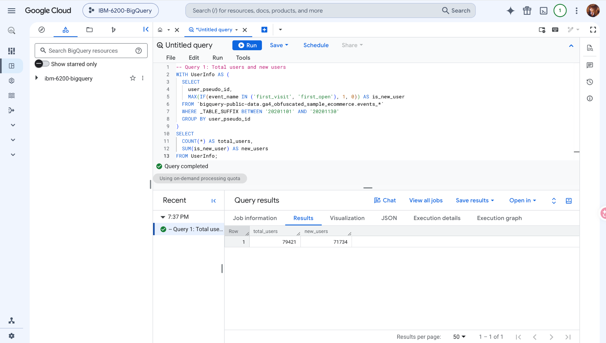
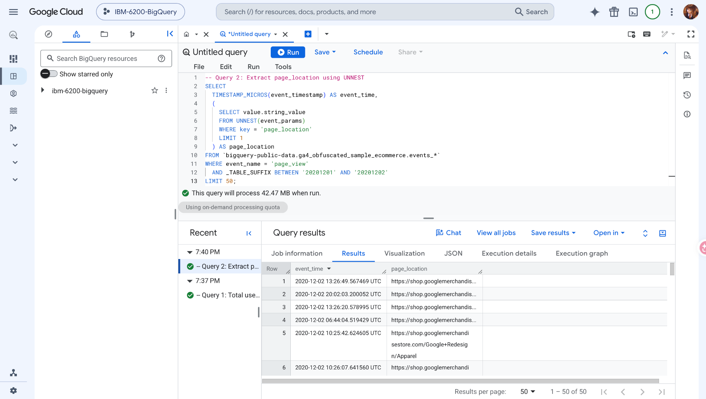
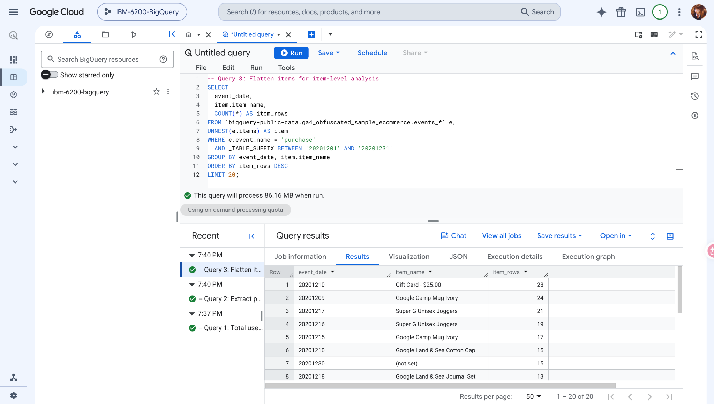
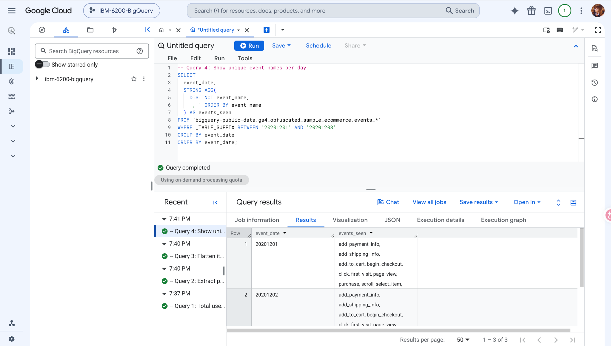
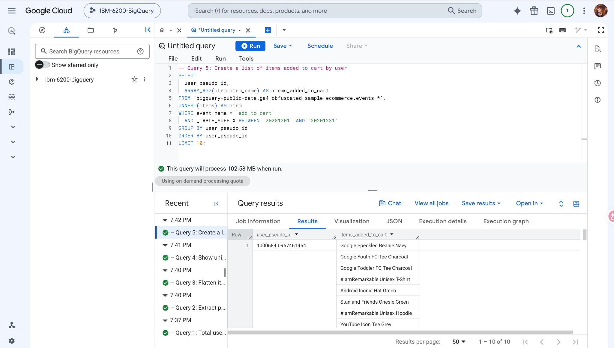
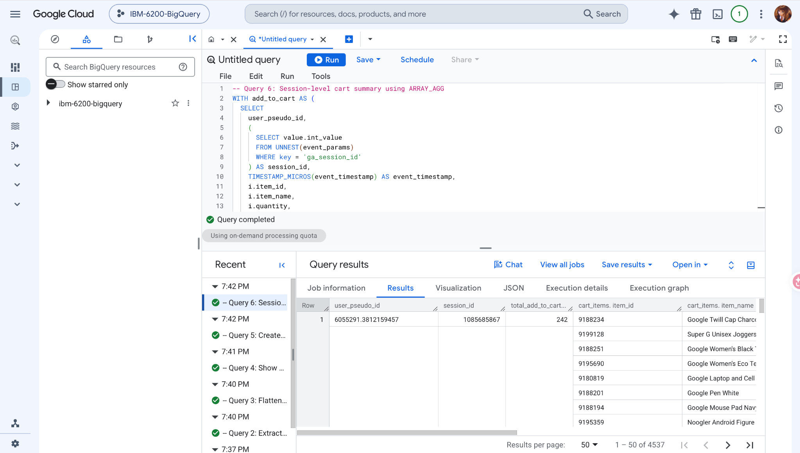
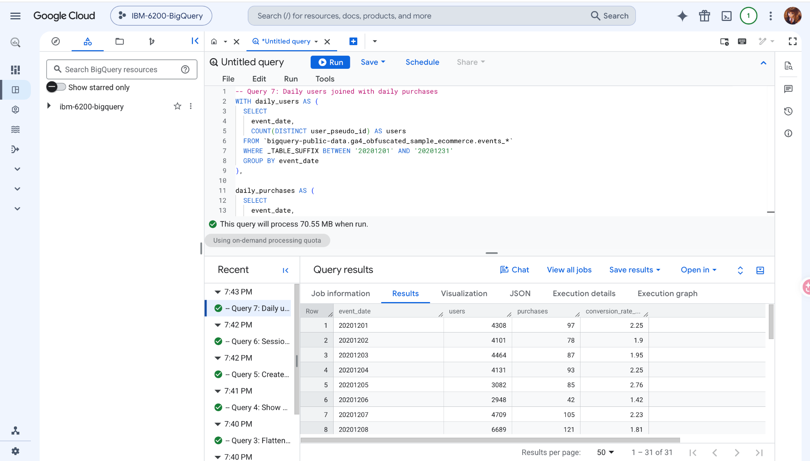
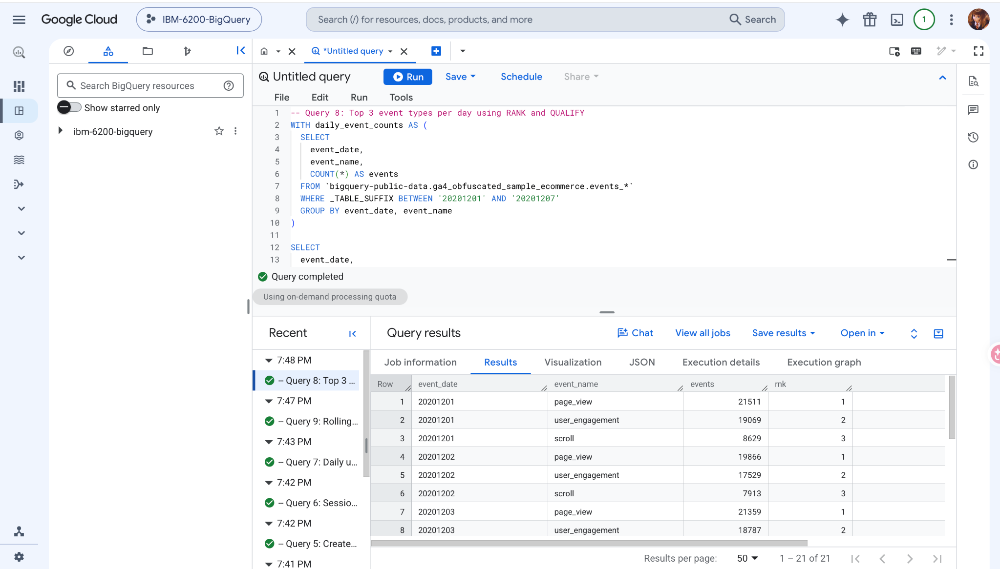
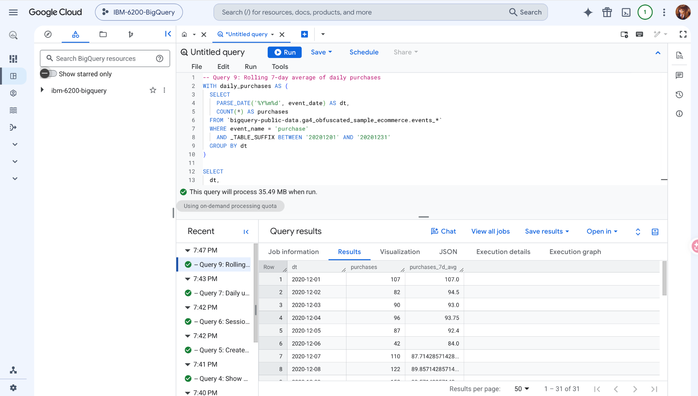
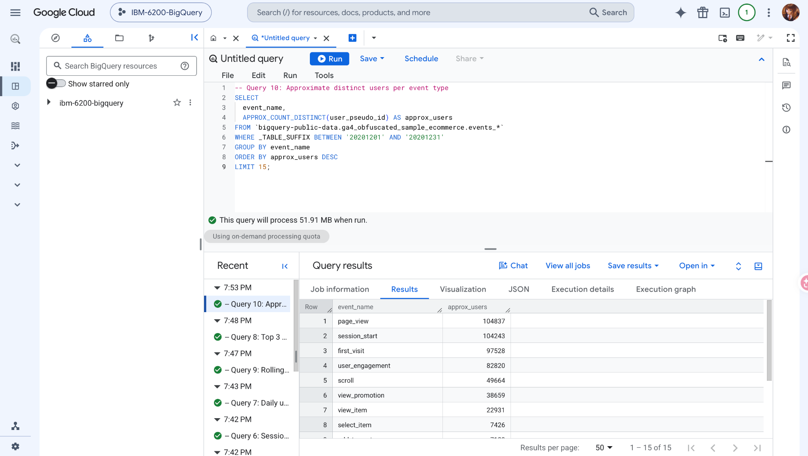

# 1. CTEs (`WITH`)

## Query 1 — Total users and new users

``` sql
WITH UserInfo AS (
  SELECT
    user_pseudo_id,
    MAX(IF(event_name IN ('first_visit', 'first_open'), 1, 0)) AS is_new_user
  FROM `bigquery-public-data.ga4_obfuscated_sample_ecommerce.events_*`
  WHERE _TABLE_SUFFIX BETWEEN '20201101' AND '20201130'
  GROUP BY user_pseudo_id
)
SELECT
  COUNT(*) AS total_users,
  SUM(is_new_user) AS new_users
FROM UserInfo;
```

What the query does: The CTE creates one row per pseudonymous user for November 2020. `MAX(IF(...))` marks users who had a `first_visit` or `first_open` event, then the final query counts all users and sums the new-user flags. The result represents pseudonymous users recorded in the selected period.

What the output shows: BigQuery returned 79,421 total users and 71,734 new users for November 2020. New users are a subset of total users.

BigQuery result screenshot:

{fig-alt="BigQuery result screenshot for query 1" width="100%"}

# 2. Arrays + `UNNEST`

## Query 2 — Pattern A: Extract page location

``` sql
SELECT
  TIMESTAMP_MICROS(event_timestamp) AS event_time,
  (
    SELECT value.string_value
    FROM UNNEST(event_params)
    WHERE key = 'page_location'
    LIMIT 1
  ) AS page_location
FROM `bigquery-public-data.ga4_obfuscated_sample_ecommerce.events_*`
WHERE event_name = 'page_view'
  AND _TABLE_SUFFIX BETWEEN '20201201' AND '20201202'
LIMIT 50;
```

What the query does: This query looks at `page_view` events on December 1–2, 2020. A scalar subquery extracts the `page_location` value from each event’s repeated `event_params` field, without expanding the outer event rows.

What the output shows: The output shows page-view timestamps and Google Merchandise Store page URLs. The query returns 50 page-view records from December 1–2, 2020.

BigQuery result screenshot:

{fig-alt="BigQuery result screenshot for query 2" width="100%"}

## Query 3 — Pattern B: Purchase items

``` sql
SELECT
  event_date,
  item.item_name,
  COUNT(*) AS item_rows
FROM `bigquery-public-data.ga4_obfuscated_sample_ecommerce.events_*` AS e,
UNNEST(e.items) AS item
WHERE e.event_name = 'purchase'
  AND _TABLE_SUFFIX BETWEEN '20201201' AND '20201231'
GROUP BY event_date, item.item_name
ORDER BY item_rows DESC
LIMIT 20;
```

What the query does: `UNNEST(e.items)` creates a separate row for each item record in a purchase event. The query counts item rows by date and product name, then shows the 20 largest counts in December 2020.

What the output shows: The top displayed result is Gift Card - \$25.00 on December 10, 2020, with 28 item rows. These represent item records, not purchased quantities.

BigQuery result screenshot:

{fig-alt="BigQuery result screenshot for query 3" width="100%"}

# 3. `STRING_AGG` + `ARRAY_AGG`

## Query 4 — STRING_AGG: Event names by day

``` sql
SELECT
  event_date,
  STRING_AGG(DISTINCT event_name, ', ' ORDER BY event_name) AS events_seen
FROM `bigquery-public-data.ga4_obfuscated_sample_ecommerce.events_*`
WHERE _TABLE_SUFFIX BETWEEN '20201201' AND '20201203'
GROUP BY event_date
ORDER BY event_date;
```

What the query does: This groups events by date and uses `STRING_AGG` to combine the distinct event names seen on each day into one comma-separated text field. The names are sorted alphabetically.

What the output shows: The results show three dates, December 1–3, 2020. Each row combines distinct events such as `page_view`, `add_to_cart`, and `purchase` into a single field.

BigQuery result screenshot:

{fig-alt="BigQuery result screenshot for query 4" width="100%"}

## Query 5 — `ARRAY_AGG`: Items added by user (Use Case 1)

``` sql
SELECT
  user_pseudo_id,
  ARRAY_AGG(item.item_name) AS items_added_to_cart
FROM `bigquery-public-data.ga4_obfuscated_sample_ecommerce.events_*`,
UNNEST(items) AS item
WHERE event_name = 'add_to_cart'
  AND _TABLE_SUFFIX BETWEEN '20201201' AND '20201231'
GROUP BY user_pseudo_id
ORDER BY user_pseudo_id
LIMIT 10;
```

What the query does: This query unnests the product items on `add_to_cart` events and builds an array of item names for each pseudonymous user during December 2020.

What the output shows: The output lists 10 users, each with an array of products added to carts. One displayed array includes the Google Speckled Beanie Navy and Google Youth FC Tee Charcoal.

BigQuery result screenshot:

{fig-alt="BigQuery result screenshot for query 5" width="100%"}

## Query 6 — `ARRAY_AGG`: Session cart summary (Use Case 2)

``` sql
WITH add_to_cart AS (
  SELECT
    user_pseudo_id,
    (
      SELECT value.int_value
      FROM UNNEST(event_params)
      WHERE key = 'ga_session_id'
    ) AS session_id,
    TIMESTAMP_MICROS(event_timestamp) AS event_timestamp,
    i.item_id,
    i.item_name,
    i.quantity,
    i.price
  FROM `bigquery-public-data.ga4_obfuscated_sample_ecommerce.events_*`,
  UNNEST(items) AS i
  WHERE event_name = 'add_to_cart'
    AND _TABLE_SUFFIX BETWEEN '20210101' AND '20211231'
)
SELECT
  user_pseudo_id,
  session_id,
  COUNT(*) AS total_add_to_cart_events,
  ARRAY_AGG(
    STRUCT(item_id, item_name, quantity, price, event_timestamp)
    ORDER BY quantity DESC, event_timestamp ASC
    LIMIT 10
  ) AS cart_items
FROM add_to_cart
WHERE session_id IS NOT NULL
GROUP BY user_pseudo_id, session_id;
```

What the query does: A CTE extracts the session ID and individual items on add-to-cart events. The final query groups by user and session, counts added item rows, and uses `ARRAY_AGG(STRUCT(...))` to retain up to 10 detailed cart-item records per session. The date predicate extends through 2021, although the sample ends in January 2021.

What the output shows: BigQuery returned 4,537 session-level rows. The first visible session has a value of 242 in `total_add_to_cart_events`, but this SQL count represents unnested added-item rows, not necessarily separate events. The `cart_items` array retains up to ten product details per session.

BigQuery result screenshot:

{fig-alt="BigQuery result screenshot for query 6" width="100%"}

# 4. Joins (`LEFT JOIN`)

## Query 7 — LEFT JOIN: Daily users and purchases

``` sql
WITH daily_users AS (
  SELECT
    event_date,
    COUNT(DISTINCT user_pseudo_id) AS users
  FROM `bigquery-public-data.ga4_obfuscated_sample_ecommerce.events_*`
  WHERE _TABLE_SUFFIX BETWEEN '20201201' AND '20201231'
  GROUP BY event_date
),
daily_purchases AS (
  SELECT
    event_date,
    COUNT(DISTINCT ecommerce.transaction_id) AS purchases
  FROM `bigquery-public-data.ga4_obfuscated_sample_ecommerce.events_*`
  WHERE event_name = 'purchase'
    AND _TABLE_SUFFIX BETWEEN '20201201' AND '20201231'
  GROUP BY event_date
)
SELECT
  u.event_date,
  u.users,
  IFNULL(p.purchases, 0) AS purchases,
  ROUND(
    IFNULL(p.purchases, 0) / NULLIF(u.users, 0) * 100,
    2
  ) AS conversion_rate_pct
FROM daily_users AS u
LEFT JOIN daily_purchases AS p
  ON u.event_date = p.event_date
ORDER BY u.event_date;
```

What the query does: Two CTEs count daily unique users and daily distinct purchase transactions in December 2020. A `LEFT JOIN` preserves the daily-user dates even when no matching purchase row exists; `IFNULL` then displays zero, and `NULLIF` protects the percentage calculation from division by zero.

What the output shows: On December 1, 2020, the output shows 4,308 users, 97 transactions, and 2.25 in `conversion_rate_pct`. This is transactions per user × 100, rather than the percentage of users who purchased.

BigQuery result screenshot:

{fig-alt="BigQuery result screenshot for query 7" width="100%"}

# 5. Window functions + `QUALIFY`

## Query 8 — Top event types by day with RANK

``` sql
WITH daily_event_counts AS (
  SELECT
    event_date,
    event_name,
    COUNT(*) AS events
  FROM `bigquery-public-data.ga4_obfuscated_sample_ecommerce.events_*`
  WHERE _TABLE_SUFFIX BETWEEN '20201201' AND '20201207'
  GROUP BY event_date, event_name
)
SELECT
  event_date,
  event_name,
  events,
  RANK() OVER (PARTITION BY event_date ORDER BY events DESC) AS rnk
FROM daily_event_counts
QUALIFY rnk <= 3
ORDER BY event_date, rnk;
```

What the query does: The CTE first counts each event type per day for December 1–7. `RANK()` ranks event types within each date, and `QUALIFY` keeps those ranked 1 through 3.

What the output shows: For December 1, 2020, `page_view` ranked first with 21,511 events, `user_engagement` second with 19,069, and `scroll` third with 8,629.

BigQuery result screenshot:

{fig-alt="BigQuery result screenshot for query 8" width="100%"}

## Query 9 — Rolling 7-day average of purchases

``` sql
WITH daily_purchases AS (
  SELECT
    PARSE_DATE('%Y%m%d', event_date) AS dt,
    COUNT(*) AS purchases
  FROM `bigquery-public-data.ga4_obfuscated_sample_ecommerce.events_*`
  WHERE event_name = 'purchase'
    AND _TABLE_SUFFIX BETWEEN '20201201' AND '20201231'
  GROUP BY dt
)
SELECT
  dt,
  purchases,
  AVG(purchases) OVER (
    ORDER BY dt
    ROWS BETWEEN 6 PRECEDING AND CURRENT ROW
  ) AS purchases_7d_avg
FROM daily_purchases
ORDER BY dt;
```

What the query does: The CTE counts purchase events for each date. The window function takes the mean of the current day and up to six previous rows to smooth day-to-day variation. Because this version only includes dates with purchases, the window covers seven available rows (rather than exactly seven consecutive calendar days if any day has no purchases).

What the output shows: The output shows 107 purchases on December 1 and 82 on December 2. The second row’s rolling average is 94.5. The first six rows use fewer than seven days.

BigQuery result screenshot:

{fig-alt="BigQuery result screenshot for query 9" width="100%"}

# 6. Approximate functions

## Query 10 — Approximate distinct users by event type

``` sql
SELECT
  event_name,
  APPROX_COUNT_DISTINCT(user_pseudo_id) AS approx_users
FROM `bigquery-public-data.ga4_obfuscated_sample_ecommerce.events_*`
WHERE _TABLE_SUFFIX BETWEEN '20201201' AND '20201231'
GROUP BY event_name
ORDER BY approx_users DESC
LIMIT 15;
```

What the query does: This groups December 2020 records by event name and uses `APPROX_COUNT_DISTINCT` to estimate the number of unique pseudonymous users associated with each event type. It returns the top 15 groups.

What the output shows: `page_view` has the highest displayed estimate at 104,837 users, followed by `session_start` at 104,243 and `first_visit` at 97,528. These are approximate distinct-user counts.

BigQuery result screenshot:

{fig-alt="BigQuery result screenshot for query 10" width="100%"}

# Key takeaways

In this lecture, I practiced building queries with CTEs, extracting nested GA4 data using `UNNEST`, and combining values with `STRING_AGG` and `ARRAY_AGG`. I also used a `LEFT JOIN` for daily reporting, window functions to rank and smooth results, and an approximate distinct count to summarize user reach. The most important point is to check the level of detail before interpreting a number: user records, events, transactions, and unnested item rows are not interchangeable.

# Appendix — GitHub project links

- [GitHub Pages](https://sheilaaa0312.github.io/Luo-Xueying-lecture2-ga4/)
- [GitHub repository](https://github.com/Sheilaaa0312/Luo-Xueying-lecture2-ga4)
